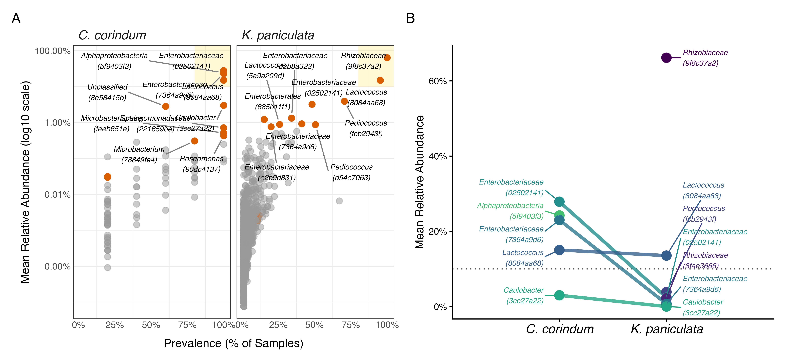

# The soapberry bug microbiome project

[Manuscript now on bioRxiv](https://www.biorxiv.org/content/10.64898/2026.10.28.762591v1).

## Host specificity, seasonality, and urbanicity shape the gut microbiome of a synanthropic insect

Hanna Noyes, Nur-E-Jannat Anika, Julia Combs, Tamheeda Khan, Josefine Just, Rowan Graham Angelini, Su Fitzpatrick, and David R. Angelini

### Abstract

The soapberry bug *Jadera haematoloma* is a classic model of rapid adaptive evolution, with a well-documented host shift from native herbaceous sapinds to the introduced goldenrain tree (*Koelreuteria* spp.). This host shift has facilitated the insect's spread into novel anthropogenic urban habitats. Microbial associations are often critical to insect environmental adaptation. Here, we characterize the gut microbiota of *J. haematoloma* across native and introduced host plants, seasonal transitions, and a gradient of urbanicity. Our findings indicate that the soapberry bug gut microbiome is highly specialized, with a small number of core bacterial amplicon sequence variants (ASVs) primarily from the families Rhizobiaceae, Streptococcaceae, Enterobacteriaceae, and Lactobacillaceae. While traits such as sex and wing morph do not correlate with microbiome structure, the host plant acts as the primary determinant of community composition. Bugs feeding on the ancestral host plant maintain a more diverse and even microbial community featuring Enterobacteriaceae, whereas the gut environment of bugs on the introduced host is overwhelmingly dominated by a single unclassified Rhizobiaceae ASV. Furthermore, seasonal transitions drive significant turnover among accessory microbial taxa. Finally, we demonstrate that urbanization introduces a distinct ecological effect on the insect's microbiome. While the degree of local green space does not systematically alter within-host taxonomic richness, it is associated with modest change in mean community composition and significantly disrupts microbial community variance. Increased urbanization correlates with significantly higher beta dispersion, indicating that anthropogenic environments lead to more stochastic microbiomes, which may be an indicator of environmental stress. Together, these results illustrate how rapid dietary host shifts and the ecological pressures of urbanization interact to shape the microbiome of a synanthropic insect.

---

[***Bugs in our Backyard***](https://bugsinourbackyard.org/)
